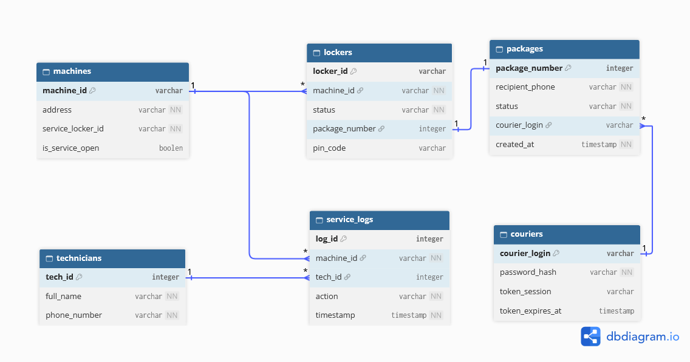

# IoT Locker System - Backend API

Serwerowy moduł backendowy prototypu skrytek pocztowych. Aplikacja udostępnia interfejs REST API zbudowany w oparciu o framework FastAPI, odpowiedzialny za zarządzanie stanem skrytek, autoryzację kurierów i serwisantów oraz obsługę procesu wydawania i nadawania paczek. System współpracuje z klientem fizycznym, Raspberry Pi z kontrolerem diod RGB.

---

## Stos technologiczny

* **Język:** Python 3.14.4
* **Framework API:** FastAPI
* **Serwer ASGI:** Uvicorn
* **ORM:** SQLAlchemy
* **Baza danych:** SQLite
* **Walidacja danych:** Pydantic
* **Dokumentacja API:** Swagger UI / ReDoc (wbudowane w FastAPI)

---

## Struktura projektu

```text
IoT-Locker-backend/
├── app/
│   ├── __init__.py
│   ├── main.py              
│   ├── database.py          
│   ├── database_model.py   
│   └── schemas.py           
├── scripts/
│   └── seed.py
├── app.db
├── requirements.txt 
└── README.md
```
### Opis plików i katalogów:

* **app/** – Główny katalog logiki aplikacji serwerowej:

* **main.py** – Punkt startowy aplikacji FastAPI zawierający definicje ścieżek (endpointów) REST API.

* **database.py** – Konfiguracja połączenia z bazą danych SQLite oraz zarządzanie sesjami SQLAlchemy.

* **database_model.py** – Definicje struktur tabel i relacji bazodanowych (modele ORM).

* **schemas.py** – Schematy Pydantic służące do walidacji danych wejściowych i struktury odpowiedzi JSON.

* **scripts/** – Skrypty pomocnicze:

* **seed.py** – Skrypt automatycznie czyszczący i zasilający bazę danych wstępnymi danymi testowymi.

* **app.db** – Lokalny plik bazy danych SQLite (generowany automatycznie przy uruchomieniu).


## Model bazy danych



## Uruchomienie projektu lokalnie
### 1. Wymagania wstępne

Upewnij się, że masz zainstalowanego Pythona w wersji 3.10 lub nowszej.

### 2. Klonowanie repozytorium i konfiguracja środowiska
```Bash
# Utworzenie i aktywacja wirtualnego środowiska
python3 -m venv venv
source venv/bin/activate  # Dla systemu Linux / macOS
# venv\Scripts\activate   # Dla systemu Windows
```

### 3. Instalacja wymaganych pakietów
```Bash
pip install fastapi uvicorn sqlalchemy pydantic
```
### 4. Zasilenie bazy danych danymi testowymi (seed)

Przed pierwszym uruchomieniem serwera wygeneruj świeżą bazę danych z domyślnym układem skrytek dla maszyny KR001:
```Bash
python -m scripts.seed
```

Skrypt utworzy maszynę KR001, 5 skrytek klienckich (POX001–POX005), skrytkę serwisową SRV001 oraz testowe paczki i kody PIN.

### 5. Uruchomienie serwera API
```Bash
uvicorn app.main:app --host 127.0.0.1 --port 8000 --reload
```

Serwer wystartuje lokalnie pod adresem [http://127.0.0.1:8000] i będzie gotowy do obsługi ruchu przekazywanego przez Nginx.
