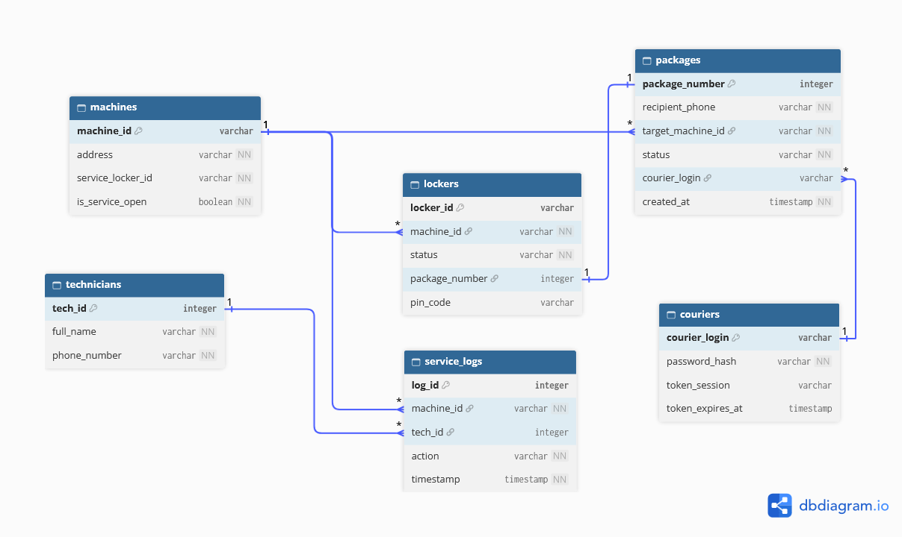

# IoT Locker System - Backend API

Serwerowy moduł backendowy prototypu skrytek pocztowych. Aplikacja udostępnia interfejs REST API zbudowany w oparciu o framework FastAPI, odpowiedzialny za zarządzanie stanem skrytek, autoryzację kurierów i serwisantów oraz obsługę procesu wydawania i nadawania paczek. System współpracuje z klientem fizycznym (Raspberry Pi z kontrolerem diod RGB), a całość ruchu jest zabezpieczona i pośredniczona przez serwer Nginx oraz tunel Ngrok.

---

## Stos technologiczny

- **Język:** Python 3.14.4
- **Framework API:** FastAPI
- **Serwer ASGI:** Uvicorn
- **Reverse Proxy / Serwer WWW:** Nginx (wer. 1.28.3)
- **Bezpieczeństwo / Kryptografia:** `argon2-cffi` (Argon2id dla haseł), wbudowane biblioteki `hashlib` (SHA-256 z pieprzem `PIN_PEPPER` dla kodów PIN i tokenów sesji) oraz `secrets`
- **ORM:** SQLAlchemy
- **Baza danych:** SQLite
- **Walidacja danych:** Pydantic v2
- **Testy:** `pytest`, `httpx`, `keyring` (testy integracyjne E2E oraz weryfikacja zabezpieczeń warstwy API i Nginx przez tunel Ngrok)
- **Dokumentacja API:** Swagger UI (wbudowane w FastAPI, wyłączone za proxy w konfiguracji Nginx)

---

## Struktura projektu

```text
IoT-Locker-backend/
├── app/
│   ├── routers/
│   │   ├── clients.py
│   │   ├── couriers.py
│   │   └── system.py
│   ├── .env                      # Zmienne środowiskowe aplikacji (ignorowane w Git)
│   ├── database.py
│   ├── database_model.py
│   ├── logging_config.py
│   ├── main.py
│   ├── schemas.py
│   └── security.py
├── diagrams/
│   └── database_schema.png
├── nginx/
│   └── lockers.conf
├── screens/
│   ├── server-verification/      
│   └── startup-conf/             
├── scripts/
│   ├── .env                      # Konfiguracja dla skryptów CLI (ignorowane w Git)
│   ├── cli_couriers.py
│   ├── cli_machines.py
│   ├── cli_technicians.py
│   ├── cli_verify_tech.py
│   └── seed.py
├── tests/
│   ├── .env                      # Konfiguracja środowiska testowego (ignorowane w Git)
│   ├── conftest.py
│   ├── test_e2e_flow.py
│   └── test_security.py
├── .gitignore
├── README.md
└── requirements.txt
```

### Opis plików i katalogów:

- **app/** – Główny katalog logiki aplikacji serwerowej:
  - **routers/** – Katalog zawierający podzielone moduły endpointów API (`clients.py`, `couriers.py`, `system.py`).
  - **main.py** – Punkt startowy aplikacji FastAPI integrujący routery oraz konfigurację logowania.
  - **logging_config.py** – Konfiguracja rejestracji zdarzeń systemowych i bezpieczeństwa (`app.log`).
  - **database.py** – Konfiguracja połączenia z bazą danych SQLite oraz zarządzanie sesjami SQLAlchemy.
  - **database_model.py** – Definicje struktur tabel i relacji bazodanowych (modele ORM).
  - **schemas.py** – Schematy Pydantic służące do ścisłej walidacji danych wejściowych (np. weryfikacja regex dla numerów telefonów, PIN-ów i identyfikatorów maszyn) oraz struktury odpowiedzi JSON.
  - **security.py** – Moduł obsługujący autoryzację (`X-API-Key`), weryfikację tokenów sesyjnych oraz kryptografię (haszowanie haseł przez `PasswordHasher` z `argon2-cffi`, weryfikacja względem `DUMMY_HASH` chroniąca przed atakami czasowymi oraz haszowanie SHA-256 ze statycznym pieprzem `PIN_PEPPER` dla kodów PIN i tokenów).
- **nginx/** – Konfiguracja infrastruktury:
  - **lockers.conf** – Plik konfiguracyjny serwera Nginx pełniącego rolę reverse proxy, zawierający strefy Rate Limitingu (`429`), nagłówki bezpieczeństwa z parametrem `always`, ograniczenie metod HTTP do `GET`/`POST`, ukrywanie dokumentacji `/docs` oraz bezpieczne odtwarzanie adresu IP klienta z zaufanego tunelu lokalnego (`127.0.0.1` / `::1`).
- **diagrams/** – Dokumentacja graficzna modelu danych (`database_schema.png`).
- **screens/** – Zrzuty ekranu dokumentujące konfigurację startową oraz weryfikację zabezpieczeń serwera (TLS/Ngrok, UFW, logi i nagłówki Nginx).
- **scripts/** – Skrypty administracyjne i pomocnicze CLI:
  - **cli_couriers.py**, **cli_machines.py**, **cli_technicians.py**, **cli_verify_tech.py** – Narzędzia dla administratora do zarządzania bazą danych oraz symulacji weryfikacji serwisanta bezpośrednio z poziomu wiersza poleceń.
  - **seed.py** – Skrypt interaktywnie czyszczący (po potwierdzeniu `[T/N]`) i zasilający bazę danych wstępnymi danymi testowymi.
- **tests/** – Zestaw testów automatycznych (`pytest`):
  - **conftest.py** – Wspólne fikstury i konfiguracja połączenia dla zestawu testów.
  - **test_e2e_flow.py** – Testy pełnego przepływu biznesowego (nadanie, odbiór paczki, obsługa kuriera i trybu serwisowego).
  - **test_security.py** – Testy kontroli dostępu (`X-API-Key`), nagłówków bezpieczeństwa oraz limitowania zapytań w Nginx.
- **requirements.txt** – Lista wszystkich zależności i pakietów Pythona wymaganych do uruchomienia aplikacji, skryptów oraz testów.

---

## Model bazy danych



---

## Uruchomienie projektu lokalnie

### 1. Wymagania wstępne
Upewnij się, że masz zainstalowanego Pythona (najlepiej 3.14) oraz serwer Nginx.

### 2. Konfiguracja środowiska wirtualnego
```bash
# Utworzenie i aktywacja wirtualnego środowiska
python3 -m venv venv
source venv/bin/activate  # Dla systemu Linux
```

### 3. Instalacja wymaganych pakietów
Dzięki plikowi `requirements.txt` instalacja jest zautomatyzowana:
```bash
pip install -r requirements.txt
```

### 4. Konfiguracja zmiennych środowiskowych (`.env`)
Projekt wykorzystuje rozdzielone pliki `.env` izolujące sekrety aplikacji serwerowej od narzędzi CLI i testów.

Utwórz plik `app/.env` i uzupełnij wymagane zmienne:
   ```env
   ADMIN_API_KEY=twoj_tajny_klucz_admina
   RASP_API_KEY=twoj_tajny_klucz_malinki
   PIN_PEPPER=losowy_dlugi_ciag_znakow_do_solenia_pinow_i_tokenow
   ```

Utwórz plik `tests/.env` i uzupełnij wymagane zmienne:
   ```env
   NGROK_URL=adres_url_ngrok
   ADMIN_API_KEY=twoj_tajny_klucz_admina
   RASP_API_KEY=twoj_tajny_klucz_malinki
   ```

Utwórz plik `scripts/.env`, wskazując adres lokalnego proxy Nginx oraz klucz API używany do komunikacji z endpointami maszyn:
   ```env
   API_URL=http://127.0.0.1:8000
   ADMIN_API_KEY=twoj_tajny_klucz_admina
   ```

### 5. Zasilenie bazy danych danymi testowymi (seed)
Przed pierwszym uruchomieniem serwera (oraz przed uruchomieniem testów E2E) wygeneruj schemat bazy i testowe dane dla maszyny `KR001`:
```bash
python -m scripts.seed
```
Skrypt poprosi o potwierdzenie wyczyszczenia tabel (`[T/N]`), a następnie utworzy maszynę `KR001`, 5 skrytek klienckich (`KR001_POX1`–`POX5`), skrytkę serwisową `KR001_SRV1` oraz testowe paczki i konta dostępowe.

### 6. Uruchomienie serwera API (Uvicorn)
```bash
uvicorn app.main:app --host 127.0.0.1 --port 8000 --reload
```
Serwer backendu wystartuje lokalnie pod adresem `http://127.0.0.1:8000`.

### 7. Konfiguracja Nginx (Reverse Proxy)
Aby włączyć zabezpieczenia (limitowanie zapytań, nagłówki bezpieczeństwa, ukrycie dokumentacji API), skopiuj plik konfiguracyjny do katalogu Nginx i przeładuj usługę:
```bash
sudo cp nginx/lockers.conf /etc/nginx/sites-available/
sudo ln -s /etc/nginx/sites-available/lockers.conf /etc/nginx/sites-enabled/
sudo nginx -t
sudo systemctl restart nginx
```
Od tego momentu cały ruch kierowany jest na port `80` (`127.0.0.1:80` w Nginx), który przekazuje zweryfikowane zapytania do portu `8000` (Uvicorn). Zewnętrzny dostęp (np. z Raspberry Pi) realizowany jest za pomocą tunelu Ngrok podpiętego pod lokalnego Nginxa.

### 8. Uruchomienie testów automatycznych
Po uruchomieniu Uvicorna, przeładowaniu Nginxa, aktywowaniu tunelu Ngrok oraz zasileniu bazy skryptem `seed.py`:
```bash
pytest -v
```
